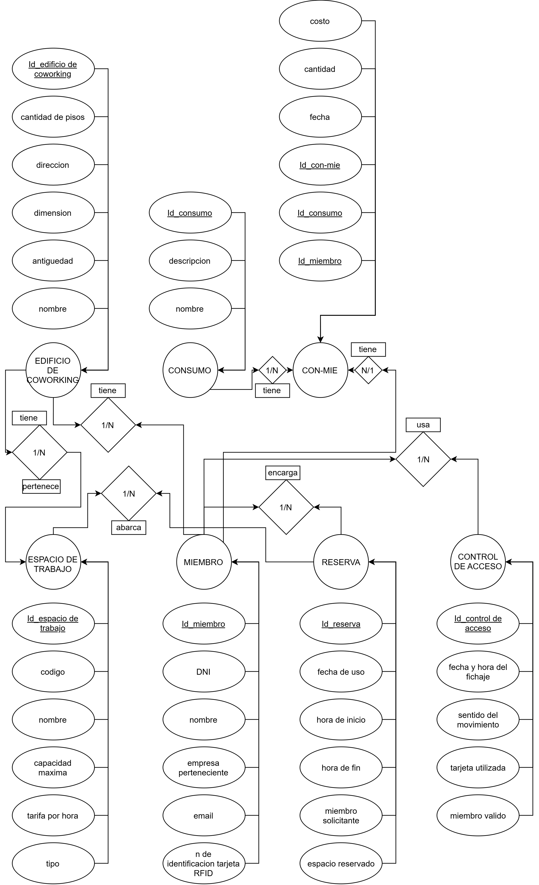

# BASE DE DATOS — Ejercicio 20: Sistema de Control de Acceso y Gestión de Espacios de Coworking

Trabajo práctico de Base de Datos (Universidad Champagnat). Este repositorio contiene todo el desarrollo del ejercicio 20: modelo entidad-relación, modelo relacional y normalización (1FN, 2FN y 3FN).

## Consigna


#### Contexto

Un centro moderno de espacios de coworking requiere un sistema automatizado para administrar la reserva de puestos de trabajo flexibles, despachos privados, salas de reuniones ejecutivas, el consumo en áreas comunes y el control de accesos mediante tarjetas inteligentes.


#### Consigna

Modelar el sistema integral de espacios de trabajo colaborativo bajo los estándares técnicos más exigentes:

El edificio de coworking cuenta con distintas áreas y espacios físicos tipificados (ej. Puesto compartido en planta baja, Despacho privado piso 2, Sala de conferencias A). Cada espacio posee un código, nombre, capacidad máxima de personas y tarifa por hora o jornada.

Los miembros (clientes del coworking) se registran aportando su DNI, nombre, empresa a la que pertenecen, correo electrónico y el número de identificación de su tarjeta RFID de acceso.

Los miembros realizan reservas de espacios. Una reserva registra la fecha de uso, hora de inicio, hora de fin, el miembro solicitante y el espacio reservado.

El sistema registra los eventos de control de acceso físico en los molinetes del edificio. Cada acceso registra la fecha y hora exacta del fichaje, el sentido del movimiento (Entrada / Salida), la tarjeta utilizada y el miembro validado.

Los miembros pueden consumir productos o servicios adicionales durante su estancia (ej. impresiones en plotter, café de barra, alquiler de proyector). De cada consumo se registra la fecha, descripción, cantidad y costo, asociándolo a la cuenta del miembro.


#### Desarrollo requerido


Modelar las entidades Espacio de Trabajo, Miembro, Reserva, Control de Acceso (Fichaje) y Consumo.

Establecer la relación temporal entre Miembro, Espacio y la Reserva, asegurando que no existan solapamientos de horarios para un mismo espacio físico.

Diseñar la relación entre la tarjeta RFID del Miembro y el registro de Control de Acceso.

Consolidar el diagrama conceptual completo aplicando buenas prácticas de nomenclatura, restricciones de unicidad y participación para garantizar un diseño robusto y normalizado.

## Estructura del repositorio

```
BASE_DE_DATOS_Ejercicio_20/
├── README.md
├── modelo-er/
│   ├── ejercicio_20.drawio        # diagrama editable (draw.io)
│   └── ejercicio_20.png           # exportación del diagrama
├── modelo-relacional/
│   ├── ejercicio_20_MR.xlsx               # modelo relacional
│   └── ejercicio_20_con_datos.xlsx        # modelo relacional con datos de ejemplo
└── normalizacion/
    ├── ejercicio_20_1FN.xlsx
    ├── ejercicio_20_2FN.xlsx
    └── ejercicio_20_3FN.xlsx
```

## Modelo entidad-relación



Archivo editable: [`modelo-er/ejercicio_20.drawio`](modelo-er/ejercicio_20.drawio).

## Modelo relacional

Tablas del modelo relacional original, antes de normalizar (`(PK)` clave primaria, `(FK)` clave foránea, `(UNIQUE)` valor único):

- **EDIFICIO DE COWORKING**: `Id_edificio de coworking(PK)`, `cantidad de pisos`, `direccion`, `dimension`, `antiguedad`, `nombre`
- **ESPACIO DE TRABAJO**: `Id_espacio de trabajo(PK)`, `codigo(UNIQUE)`, `nombre`, `capacidad maxima`, `tarifa por hora`, `tipo`, `Id_edificio de coworking(FK)`
- **MIEMBRO**: `Id_miembro(PK)`, `DNI(UNIQUE)`, `nombre`, `empresa perteneciente`, `email`, `n de identificacion tarjeta RFID(UNIQUE)`, `Id_edificio de coworking(FK)`
- **RESERVA**: `Id_reserva(PK)`, `fecha de uso`, `hora de inicio`, `hora de fin`, `Id_miembro(FK)`, `Id_espacio de trabajo(FK)`
- **CONTROL DE ACCESO**: `Id_control de acceso(PK)`, `fecha y hora del fichaje`, `sentido del movimiento`, `tarjeta utilizada`, `miembro valido`, `Id_miembro(FK)`
- **CONSUMO**: `Id_consumo(PK)`, `descripcion`, `nombre`
- **CON-MIE**: `Id_con-mie(PK)`, `Id_consumo(FK,PK)`, `Id_miembro(FK,PK)`, `fecha`, `cantidad`, `costo`

Archivos: [`ejercicio_20_MR.xlsx`](modelo-relacional/ejercicio_20_MR.xlsx) y [`ejercicio_20_con_datos.xlsx`](modelo-relacional/ejercicio_20_con_datos.xlsx).

## Lógica relacional

Cada entidad se convierte en una tabla con su clave primaria. Las relaciones se representan así:

- **1:N / N:1**: la clave primaria del lado "uno" se copia como clave foránea (FK) en la tabla del lado "muchos".
- **1:1**: igual que 1:N, pero la FK lleva restricción UNIQUE.
- **N:M**: se crea una tabla intermedia cuyas FK forman una clave compuesta, junto con una clave propia que se identifica por esa combinación.

Relaciones del modelo final (3FN):

- `ESPACIO DE TRABAJO` → `EDIFICIO DE COWORKING`: **N:1** (FK `id_edificio de coworking` en `ESPACIO DE TRABAJO`).
- `MIEMBRO` → `EDIFICIO DE COWORKING`: **N:1** (FK `id_edificio de coworking` en `MIEMBRO`).
- `RESERVA` → `MIEMBRO`: **N:1** (FK `id_miembro` en `RESERVA`).
- `RESERVA` → `ESPACIO DE TRABAJO`: **N:1** (FK `id_espacio de trabajo` en `RESERVA`).
- `CONTROL DE ACCESO` → `MIEMBRO`: **N:1** (FK `id_miembro` en `CONTROL DE ACCESO`).
- `CONSUMO` ↔ `MIEMBRO`: relación **N:M**, resuelta con la tabla intermedia `CON-MIE` (sus FK forman la clave compuesta única).

## Normalización

Los cambios se muestran etapa por etapa; cada etapa parte del resultado de la anterior.

### Primera forma normal (1FN)

- `EDIFICIO DE COWORKING`: se quitan `direccion`
- `EDIFICIO DE COWORKING`: se agregan `calle`, `numero`, `ciudad`

### Segunda forma normal (2FN)

Sin cambios respecto de la etapa anterior: el modelo ya cumplía esta forma normal.

### Tercera forma normal (3FN)

- `CONTROL DE ACCESO`: se quitan `miembro valido`
- `CONSUMO`: se agregan `precio unitario`
- `CON-MIE`: se quitan `costo`

#### Modelo final en 3FN

- **EDIFICIO DE COWORKING**: `Id_edificio de coworking(PK)`, `cantidad de pisos`, `calle`, `numero`, `ciudad`, `dimension`, `antiguedad`, `nombre`
- **ESPACIO DE TRABAJO**: `Id_espacio de trabajo(PK)`, `codigo(UNIQUE)`, `nombre`, `capacidad maxima`, `tarifa por hora`, `tipo`, `Id_edificio de coworking(FK)`
- **MIEMBRO**: `Id_miembro(PK)`, `DNI(UNIQUE)`, `nombre`, `empresa perteneciente`, `email`, `n de identificacion tarjeta RFID(UNIQUE)`, `Id_edificio de coworking(FK)`
- **RESERVA**: `Id_reserva(PK)`, `fecha de uso`, `hora de inicio`, `hora de fin`, `Id_miembro(FK)`, `Id_espacio de trabajo(FK)`
- **CONTROL DE ACCESO**: `Id_control de acceso(PK)`, `fecha y hora del fichaje`, `sentido del movimiento`, `tarjeta utilizada`, `Id_miembro(FK)`
- **CONSUMO**: `Id_consumo(PK)`, `descripcion`, `nombre`, `precio unitario`
- **CON-MIE**: `Id_con-mie(PK)`, `Id_consumo(FK,PK)`, `Id_miembro(FK,PK)`, `fecha`, `cantidad`

Archivos: [`ejercicio_20_1FN.xlsx`](normalizacion/ejercicio_20_1FN.xlsx), [`ejercicio_20_2FN.xlsx`](normalizacion/ejercicio_20_2FN.xlsx), [`ejercicio_20_3FN.xlsx`](normalizacion/ejercicio_20_3FN.xlsx).
